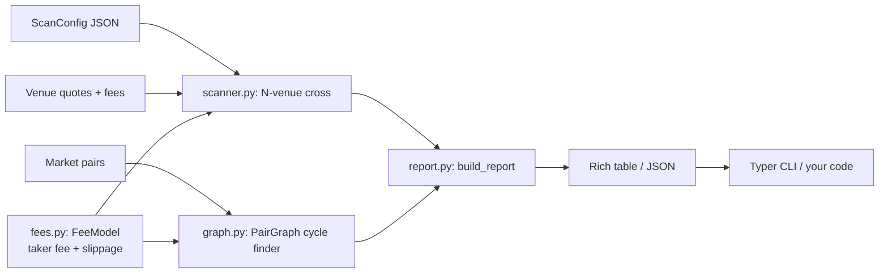

<p align="center">
  
</p>

<h1 align="center">Crypto Arbitrage Bot</h1>

<p align="center">
  <strong>Scan N exchanges for cross-venue edges and discover triangular cycles across a full pair graph — fee- and slippage-aware, in Python.</strong><br>
  Feed it quotes, get back a ranked, threshold-filtered profit report with a clear edge / no-edge verdict.
</p>

<p align="center">
  <em>Built and maintained by <a href="https://viprasol.com">Viprasol Tech</a> — Fintech Experts. Full-Stack Builders.</em>
</p>

<p align="center">
  <a href="https://github.com/Viprasol-Tech/crypto-arbitrage-bot/actions/workflows/ci.yml"></a>
  <a href="LICENSE"></a>
  
  
  
  
  <a href="https://t.me/viprasol_help"></a>
  <a href="https://github.com/Viprasol-Tech/crypto-arbitrage-bot/stargazers"></a>
</p>

---

> ## ⚠️ Disclaimer
> This software is for **educational purposes only** and is **not financial advice**. Cryptocurrency trading is highly volatile and involves substantial risk, including the **total loss of capital**. Detected "edges" are estimates from the data *you* supply; real fills are subject to latency, withdrawal/transfer limits, depth, partial fills, and execution risk, and are **not** indicative of realised profit. The slippage model here is a first-order approximation, not a microstructure simulator. Always validate independently and comply with each exchange's terms and your local laws. **Use at your own risk** — Viprasol Tech assumes no responsibility for your trading results.

---

## ✨ Features

- 🌐 **N-exchange cross scanner** — watch one pair across many venues; `scan_cross` returns the best buy-here / sell-there pairing and `rank_cross` ranks every directed pair by net edge.
- 🔺 **Triangular cycle finder** — model the order book as a directed pair graph and let `PairGraph.find_cycles` *discover* every profitable loop (triangles and longer), not just one you hand-built.
- 💸 **Fee + slippage modelling** — `FeeModel` converts a quote into a realistic effective fill price using a taker fee plus a transparent linear, optionally size-aware, slippage charge.
- 📊 **Profit / opportunity report** — merge cross and triangular results into one ranked, threshold-filtered `Report`, rendered as a Rich table or serialised to JSON.
- ⚙️ **Config-driven** — drive a scan from a single validated `ScanConfig` JSON file (`init-config` writes a starter for you).
- 🖥️ **CLI subcommands** — `scan-cross`, `scan-triangular`, `init-config`, plus a zero-setup `demo`.
- 🧮 **Pure, typed, validated** — deterministic functions, Pydantic-validated inputs, mypy strict, 60 tests.

## 🚀 Quickstart

```bash
git clone https://github.com/Viprasol-Tech/crypto-arbitrage-bot.git
cd crypto-arbitrage-bot
python -m pip install -e ".[dev]"

# Zero-setup demos on illustrative quotes:
crypto-arbitrage-bot demo --mode both    # cross + triangular tables
crypto-arbitrage-bot demo --mode scan    # combined ranked report

# Scan your own data (JSON files):
crypto-arbitrage-bot scan-cross quotes.json --pair BTC/USDT --min-edge-pct 0.1
crypto-arbitrage-bot scan-triangular pairs.json --max-len 3

# Write a starter config you can edit:
crypto-arbitrage-bot init-config arb-config.json
```

`quotes.json` is a list of venue quotes; `pairs.json` is a list of market pairs:

```json
[ {"exchange": "binance", "price": 50000.0},
  {"exchange": "kraken",  "price": 50300.0, "fees": {"taker_fee": 0.001, "slippage_bps": 5}} ]
```

```json
[ {"base": "BTC", "quote": "USDT", "price": 50000.0},
  {"base": "ETH", "quote": "BTC",  "price": 0.06},
  {"base": "ETH", "quote": "USDT", "price": 3150.0} ]
```

## 🧩 Use it in code

```python
from crypto_arbitrage_bot import (
    FeeModel,
    VenueQuote,
    rank_cross,
    MarketPair,
    PairGraph,
    build_report,
    render_table,
)
from rich.console import Console

# 1) N-exchange cross scan for one pair, fee + slippage aware.
board = [
    VenueQuote(exchange="binance", price=50_000.0, fees=FeeModel(taker_fee=0.001, slippage_bps=5)),
    VenueQuote(exchange="kraken", price=50_300.0, fees=FeeModel(taker_fee=0.001, slippage_bps=5)),
    VenueQuote(exchange="coinbase", price=49_950.0, fees=FeeModel(taker_fee=0.001, slippage_bps=5)),
]
cross = rank_cross("BTC/USDT", board, profitable_only=True)

# 2) Triangular cycles discovered over a full pair graph.
graph = PairGraph(
    [
        MarketPair(base="BTC", quote="USDT", price=50_000.0),
        MarketPair(base="ETH", quote="BTC", price=3_000.0 / 50_000.0),
        MarketPair(base="ETH", quote="USDT", price=3_150.0),  # ETH dear -> a cycle edge
    ]
)
cycles = graph.find_cycles(max_len=3, profitable_only=True)

# 3) One ranked, threshold-filtered report.
report = build_report(cross=cross, cycles=cycles, min_edge_pct=0.1)
Console().print(render_table(report))
print("best edge:", report.best_edge_pct, "%")
```

## 🏗️ Architecture



## 📚 API & CLI reference

| Component | What it does |
| --- | --- |
| `FeeModel.effective_price` | Adjust a quote for taker fee + slippage on a buy or sell. |
| `cross_exchange_profit` | Pairwise net edge between two venues for one pair. |
| `scan_cross` / `rank_cross` | Best / ranked cross opportunities across N venues. |
| `PairGraph.find_cycles` | Discover profitable triangular (and longer) cycles. |
| `triangular_edge` | Evaluate one hand-built cycle's net edge. |
| `build_report` / `render_table` | Merge, rank, threshold, and display opportunities. |
| `ScanConfig.from_json` / `to_json` | Load / save validated scan parameters. |
| CLI `demo` | `--mode cross\|triangular\|scan\|both` on sample data. |
| CLI `scan-cross` | Scan a JSON quote board for cross edges. |
| CLI `scan-triangular` | Find cycles in a JSON pair graph. |
| CLI `init-config` | Write a starter `ScanConfig` JSON file. |

## 🗺️ Roadmap

- [x] Cross-exchange net-profit detector with per-venue fees
- [x] Triangular cycle edge detector with per-leg fees
- [x] N-exchange cross scanner (best + ranked) across a whole quote board
- [x] Triangular cycle finder over a full pair graph
- [x] Fee + slippage modelling (taker fee + linear, size-aware impact)
- [x] Profit/opportunity report + config-driven CLI subcommands
- [ ] Live order-book depth (size-aware edges from real book levels)
- [ ] Exchange adapters (ccxt) for real-time quotes
- [ ] Telegram alerts when an edge clears a threshold

## ❓ FAQ

**Does this place real orders?** No. It is a detector/analytics library — it reads the data you give it and reports edges. There are no API keys and no order routing.

**Where do quotes come from?** You supply them (from your own feed, a snapshot, or an exchange SDK). The CLI reads JSON; the library takes Pydantic models.

**How realistic is the slippage model?** It is a transparent first-order linear model (a flat bps charge, optionally scaled by order size vs a reference notional). It is enough to stop thin top-of-book "edges" from looking profitable, but it is not a full depth/microstructure simulation.

**Why are some triangular cycles reported with zero edge?** Two-leg back-and-forth loops on a single consistent pair net to zero before fees — they show up so you can see the full cycle set; filter with `profitable_only=True` or a `min_edge_pct`.

## 🤝 Contributing

PRs welcome — see [CONTRIBUTING.md](CONTRIBUTING.md) and our [Code of Conduct](CODE_OF_CONDUCT.md). Run `ruff check .`, `ruff format .`, `mypy src`, and `pytest` before opening a PR.

## Contact — Viprasol Tech Private Limited

- Website: [viprasol.com](https://viprasol.com)
- Email: [support@viprasol.com](mailto:support@viprasol.com)
- Telegram: [t.me/viprasol_help](https://t.me/viprasol_help) | WhatsApp: +91 96336 52112
- GitHub: [@Viprasol-Tech](https://github.com/Viprasol-Tech) | [LinkedIn](https://www.linkedin.com/in/viprasol/) | X [@viprasol](https://twitter.com/viprasol)

> *Viprasol Tech — fintech software, algorithmic trading systems, MT4/MT5 bots, AI voice agents, and B2B SaaS. Need a custom build? [Get in touch](mailto:support@viprasol.com).*

## License

[MIT](LICENSE) (c) 2025 Viprasol Tech Private Limited
