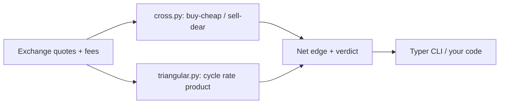

<p align="center">
  
</p>

<h1 align="center">Crypto Arbitrage Bot</h1>

<p align="center">
  <strong>Cross-exchange and triangular crypto arbitrage detector — in Python.</strong><br>
  Feed it quotes with fees, get back the net edge and a clear profitable / no-edge verdict.
</p>

<p align="center">
  <em>Built and maintained by <a href="https://viprasol.com">Viprasol Tech</a> — Fintech Experts. Full-Stack Builders.</em>
</p>

<p align="center">
  <a href="https://github.com/Viprasol-Tech/crypto-arbitrage-bot/actions/workflows/ci.yml"></a>
  <a href="LICENSE"></a>
  
  <a href="https://t.me/viprasol_help"></a>
  <a href="https://github.com/Viprasol-Tech/crypto-arbitrage-bot/stargazers"></a>
</p>

---

> ## ⚠️ Disclaimer
> This software is for **educational purposes only** and is **not financial advice**. Cryptocurrency trading is highly volatile and involves substantial risk, including the **total loss of capital**. Detected "edges" ignore slippage, latency, withdrawal limits, and execution risk, and are **not** indicative of realised profit. Always validate independently and comply with each exchange's terms and your local laws. **Use at your own risk** — Viprasol Tech assumes no responsibility for your trading results.

---

## ✨ Features

- 🔁 **Cross-exchange detector** — buy cheap, sell dear; net profit per unit after both taker fees.
- 🔺 **Triangular detector** — multiply the conversion rates around a 3-pair cycle to find the edge.
- 💸 **Fee-aware** — every quote and every leg carries its own fee; equal prices never "profit".
- 🧮 **Pure functions** — deterministic `quotes in → verdict out`, trivial to test and embed.
- ✅ **Pydantic-validated** — prices must be positive and fees must live in `[0, 1)`.
- 🖥️ **CLI** — `crypto-arbitrage-bot demo --mode both` prints both checks as rich tables.
- ⚙️ **Modern tooling** — ruff, mypy (strict), pytest, GitHub Actions CI.

## 🚀 Quickstart

```bash
git clone https://github.com/Viprasol-Tech/crypto-arbitrage-bot.git
cd crypto-arbitrage-bot
python -m pip install -e ".[dev]"

# Run both detectors on illustrative quotes:
crypto-arbitrage-bot demo --mode both
crypto-arbitrage-bot demo --mode cross
crypto-arbitrage-bot demo --mode triangular
```

## 🧩 Use it in code

```python
from crypto_arbitrage_bot.cross import ExchangeQuote, cross_exchange_profit
from crypto_arbitrage_bot.triangular import TriangularLeg, triangular_edge

# Cross-exchange: same pair, two venues, two fees.
result = cross_exchange_profit(
    ExchangeQuote(exchange="binance", price=50_000.0, fee_rate=0.001),
    ExchangeQuote(exchange="kraken", price=50_300.0, fee_rate=0.001),
)
print(result.buy_exchange, result.net_profit, result.is_profitable)

# Triangular: USDT -> BTC -> ETH -> USDT, 0.1% per leg.
legs = [
    TriangularLeg(pair="BTC/USDT", rate=1 / 50_000),
    TriangularLeg(pair="ETH/BTC", rate=50_000 / 3_000),
    TriangularLeg(pair="ETH/USDT", rate=3_150),
]
print(triangular_edge(legs, fee_rate=0.001).edge)
```

## 🏗️ Architecture



## 🗺️ Roadmap

- [x] Cross-exchange net-profit detector with per-venue fees
- [x] Triangular cycle edge detector with per-leg fees
- [ ] Live order-book depth (size-aware edges, not just top-of-book)
- [ ] Exchange adapters (ccxt) for real-time quotes
- [ ] Telegram alerts when an edge clears a threshold

## 🤝 Contributing

PRs welcome — see [CONTRIBUTING.md](CONTRIBUTING.md) and our [Code of Conduct](CODE_OF_CONDUCT.md).

## 📬 Contact — Viprasol Tech Private Limited

- 🌐 Website: [viprasol.com](https://viprasol.com)
- ✉️ Email: [support@viprasol.com](mailto:support@viprasol.com)
- 💬 Telegram: [t.me/viprasol_help](https://t.me/viprasol_help) | WhatsApp: +91 96336 52112
- 🐙 GitHub: [@Viprasol-Tech](https://github.com/Viprasol-Tech) | [LinkedIn](https://www.linkedin.com/in/viprasol/) | X [@viprasol](https://twitter.com/viprasol)

> *Viprasol Tech — fintech software, algorithmic trading systems, MT4/MT5 bots, AI voice agents, and B2B SaaS. Need a custom build? [Get in touch](mailto:support@viprasol.com).*

## 📄 License

[MIT](LICENSE) © 2025 Viprasol Tech Private Limited
